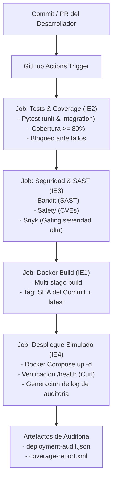

# Microservicio de Inventario y Catalogo -- Pipeline CI/CD en GitHub Actions

> **Asignatura:** DOY0101 - Ingenieria DevOps  
> **Evaluacion:** Evaluacion Parcial N 2 (EP2) -- *Anadiendole complejidad a nuestro pipeline*  
> **Integrantes:** Sebastián Osorio y Vicente Monsalve
> **Institucion:** Duoc UC -- 2026

---

## 1. Descripcion del Proyecto

Este repositorio contiene la implementacion integral del ciclo de vida (CI/CD) de un microservicio de **Gestion de Catalogo e Inventario de Productos**, desarrollado con **Python 3.12** y el framework **FastAPI**.

El microservicio expone una API REST moderna para la consulta, registro, actualizacion, eliminacion y aplicacion de reglas de negocio (descuentos en base a porcentajes y validacion de inventario), incorporando endpoints de monitoreo y healthcheck nativos para Kubernetes y Docker.

Toda la integracion, pruebas, analisis de seguridad y entrega continua estan 100% automatizadas a traves de un pipeline en **GitHub Actions**, cumpliendo estrictamente con los 5 indicadores de evaluacion (IE1 al IE5) de la rubrica oficial.

---

## 2. Arquitectura y Estructura del Repositorio

```text
devops/
|-- .github/
|   |-- dependabot.yml              # [IE3] Configuracion de escaneo semanal automatizado
|   `-- workflows/
|       `-- pipeline.yml            # [IE1-IE4] Pipeline CI/CD con gating y bloqueo
|-- app/                            # Codigo fuente del microservicio
|   |-- __init__.py                 # Version del paquete
|   |-- config.py                   # Configuracion desacoplada por variables de entorno
|   |-- main.py                     # API REST FastAPI, middlewares y rutas
|   |-- schemas.py                  # Modelos Pydantic v2 (validacion estricta de datos)
|   `-- services.py                 # Logica de negocio y persistencia en memoria
|-- tests/                          # [IE2] Suite de pruebas automatizadas
|   |-- __init__.py
|   |-- conftest.py                 # Fixtures de Pytest y cliente HTTP de prueba
|   `-- test_main.py                # Cobertura de rutas, casos de borde y errores (4xx/5xx)
|-- k8s/                            # [IE5] Manifiestos de orquestacion en Kubernetes
|   |-- deployment.yaml             # Deployment con 2 replicas, probes y limites de recursos
|   |-- service.yaml                # Servicio de red ClusterIP
|   `-- hpa.yaml                    # Horizontal Pod Autoscaler (HPA) por CPU y memoria
|-- Dockerfile                      # [IE1] Multi-stage build optimizado, no-root y healthcheck
|-- .dockerignore                   # [IE1] Minimizacion del contexto de construccion
|-- docker-compose.yml              # [IE4, IE5] Orquestacion local/simulada con replicas y limites
|-- requirements.txt                # Dependencias base de produccion
|-- requirements-dev.txt            # Dependencias de testing, cobertura y seguridad
`-- README.md                       # Documentacion tecnica, trazabilidad y reflexiones
```

---

## 3. Cumplimiento de Indicadores de Evaluacion (IE1 - IE5)

### IE1. Contenedores e Imagenes Optimizadas (20%)
* **Construccion Multi-Etapa (Multi-Stage Build):**
  * **Etapa 1 (`builder`):** Instala los compiladores necesarios y empaqueta las dependencias de Python dentro de un entorno virtual aislado (`/opt/venv`).
  * **Etapa 2 (`runtime`):** Parte de la imagen base minimalista `python:3.12-slim`, copiando unicamente el entorno virtual empaquetado y el codigo fuente. Se eliminan compiladores, caches de pip y herramientas innecesarias, reduciendo drasticamente la superficie de ataque y el peso de la imagen.
* **Seguridad No-Root:**
  * Se crea un usuario y grupo de sistema sin privilegios (`appuser:appgroup` con UID `10001`), evitando que el contenedor se ejecute con permisos de superusuario `root`.
* **Minimizacion de Contexto (`.dockerignore`):**
  * Se excluyen directorios de desarrollo como `.git`, `tests/`, `.venv`, caches de bytecode (`__pycache__`) y documentacion, garantizando builds reproducibles y veloces.
* **Healthcheck Integrado:**
  * Incluye instruccion `HEALTHCHECK` que utiliza la biblioteca estandar `urllib.request` de Python para monitorear `/health` cada 30 segundos sin necesidad de instalar dependencias externas como `curl`.

### IE2. Pruebas Automatizadas y Politicas de Calidad (20%)
* **Cobertura de Casos Criticos:**
  * Rutas principales de la API (`GET /health`, `GET /api/v1/productos`, etc.).
  * Logica de negocio (algoritmo de calculo de descuentos porcentuales y actualizacion de precios).
  * Manejo de errores y respuestas HTTP estandar (`404 Not Found` ante identificadores inexistentes, `422 Unprocessable Entity` ante payloads malformados o valores negativos).
* **Umbral de Calidad y Bloqueo:**
  * El pipeline ejecuta `pytest` junto a `pytest-cov` con la directiva `--cov-fail-under=80`. Si la cobertura del codigo es inferior al 80% o si tan solo un test falla, **el pipeline finaliza inmediatamente con codigo de error**, cancelando los pasos de empaquetado y despliegue.

### IE3. Escalabilidad, Seguridad y Gobernanza (20%)
* **Escaneo Automatizado de Dependencias (Dependabot):**
  * Configurado en `.github/dependabot.yml` para revisar semanalmente (lunes a las 06:00 AM) tanto las dependencias del ecosistema `pip` como las acciones de `github-actions`.
* **Analisis Estatico (SAST) y Vulnerabilidades:**
  * **Bandit:** Analiza estaticamente el codigo fuente en `/app` detectando practicas inseguras (severidad media y alta).
  * **Safety:** Audita las librerias declaradas en `requirements.txt` frente a bases de datos de vulnerabilidades conocidas (CVEs).
  * **Snyk CLI:** Integrado en el pipeline con la regla `--severity-threshold=high`. Si se detecta una vulnerabilidad critica o de alta severidad, el pipeline activa una alerta y **bloquea la ejecucion**.
* **Parametros de Escalabilidad:**
  * **Limites de Recursos:** Fijados en `0.50 CPU` y `256MB RAM` por replica, con reservas minimas de `0.20 CPU` y `128MB RAM`.
  * **Estrategia de Replicas:** 2 replicas activas para balanceo de carga y alta disponibilidad.

### IE4. Despliegue Automatizado y Trazabilidad (20%)
* **Gating Estricto:**
  * El job `deploy` contiene la instruccion `needs: [test, security, build]`. Si cualquiera de las etapas previas falla, el despliegue no se inicia bajo ninguna circunstancia.
* **Entorno Simulado de Despliegue:**
  * Utiliza `docker-compose` en el runner para desplegar el stack completo, aplicando politicas de reinicio automatico (`unless-stopped` / `on-failure`).
* **Verificacion Activa (Smoke Test & Healthcheck):**
  * Tras el despliegue, el pipeline ejecuta reintentos hacia `http://localhost:8000/health` y valida el endpoint funcional de productos antes de dar la entrega por exitosa.
* **Trazabilidad de Punta a Punta:**
  * Cada imagen se etiqueta con el hash del commit (`${{ github.sha }}`) y con `latest`.
  * El pipeline genera y almacena un artefacto auditado `deployment-audit.json` con los metadatos de la entrega: fecha/hora UTC, autor del commit, rama, ID de ejecucion y tag de la imagen generada.

### IE5. Orquestacion de Contenedores (20%)
El proyecto ofrece soporte de orquestacion dual:
1. **Docker Compose (`docker-compose.yml`):**
   * Configuracion de 2 replicas mediante la seccion `deploy.replicas`.
   * Mapeo de puertos por rango `8000-8001:8000` para evitar colisiones entre replicas.
   * Limitacion estricta de computo (`limits.cpus: "0.50"`, `limits.memory: "256M"`).
   * Monitoreo de estado con bloque `healthcheck` (intervalo de 15s).
   * Red bridge dedicada (`devops-network`).
2. **Kubernetes (`k8s/`):**
   * `deployment.yaml`: Controla 2 pods con politica `RollingUpdate`, sondas `livenessProbe` y `readinessProbe`, y `securityContext` sin privilegios (`runAsNonRoot: true`).
   * `service.yaml`: Balanceo interno a traves de servicio `ClusterIP`.
   * `hpa.yaml`: Escalabilidad horizontal automatica basada en metricas de CPU (umbral 70%) y memoria (umbral 80%) entre 2 y 5 replicas.

---

## 4. Como Garantizar la Trazabilidad y la Calidad

Para cumplir con la exigencia explicita del **Indicador IE4**, se detalla el flujo de trazabilidad y calidad aplicado:



1. **Trazabilidad de Codigo a Contenedor:** Cada contenedor generado tiene asignado el `GITHUB_SHA` del commit correspondiente. Esto permite rastrear con exactitud que linea de codigo origino la version que se encuentra en ejecucion.
2. **Gating de Calidad:** Ningun artefacto puede ser desplegado si no ha superado el 100% de las pruebas unitarias y alcanzado el umbral del 80% de cobertura.
3. **Gating de Seguridad:** El pipeline detiene el despliegue ante vulnerabilidades altas o codigo no conforme a los estandares de seguridad.
4. **Registro de Auditoria:** Se genera en cada ejecucion un reporte JSON inmutable que documenta el autor, la rama, el timestamp y el estado del healthcheck post-despliegue.

---

## 5. Instrucciones de Ejecucion Local

### Prerrequisitos
* Python 3.12+ (o Python 3.11+)
* Docker y Docker Compose instalados

### Opcion 1: Ejecutar directamente con Python
```bash
# Crear entorno virtual
python -m venv venv

# Activar entorno (Windows PowerShell)
.\venv\Scripts\Activate.ps1
# (Linux / macOS)
# source venv/bin/activate

# Instalar dependencias
pip install -r requirements-dev.txt

# Ejecutar las pruebas unitarias con reporte de cobertura
pytest tests/ --cov=app --cov-report=term-missing --cov-fail-under=80

# Levantar el microservicio localmente
uvicorn app.main:app --reload --port 8000
```
* Acceder a la documentacion interactiva Swagger: http://localhost:8000/docs
* Acceder al healthcheck: http://localhost:8000/health

### Opcion 2: Ejecutar con Docker
```bash
# Construir imagen multi-stage
docker build -t product-inventory-microservice:v1.0 .

# Ejecutar contenedor como usuario no-root
docker run -d -p 8000:8000 --name mi-microservicio product-inventory-microservice:v1.0

# Verificar healthcheck
curl http://localhost:8000/health
```

### Opcion 3: Orquestacion con Docker Compose
```bash
# Levantar el servicio con replicas y limites de recursos
docker compose up -d --build

# Ver estado de los contenedores y healthcheck
docker compose ps

# Ver logs
docker compose logs -f

# Detener el servicio
docker compose down
```

### Opcion 4: Orquestacion con Kubernetes (Minikube / Kind)
```bash
kubectl apply -f k8s/deployment.yaml
kubectl apply -f k8s/service.yaml
kubectl apply -f k8s/hpa.yaml

# Comprobar pods y replicas
kubectl get pods -l app=product-service
kubectl get svc product-service
```

---

## 6. Declaracion de Uso Etico de Inteligencia Artificial

De conformidad con las directrices academicas de la institucion (Bibliotecas Duoc UC - IA):

* **Herramientas utilizadas:** Antigravity (Google DeepMind - Gemini 3.8).
* **Finalidad del uso:**
  1. Apoyo en el diseno y estructuracion de la arquitectura de carpetas para el pipeline de CI/CD.
  2. Generacion de diagramas de flujo mediante sintaxis Mermaid.
  3. Revision de sintaxis en manifiestos YAML de GitHub Actions y Kubernetes.
* **Validacion tecnica humana:** Todo el codigo fuente del microservicio, las aserciones de pruebas en Pytest, las configuraciones de seguridad de Dockerfile y las politicas de bloqueo en GitHub Actions fueron revisadas, ejecutadas y validadas tecnicamente por el equipo estudiantil, asegurando su correcto funcionamiento y cumplimiento de los requisitos del proyecto.

---

## 7. Conclusiones y Reflexiones Individuales (Obligatorias)

> *Nota requerida por la rubrica institucional:* Las siguientes reflexiones personales han sido redactadas de forma individual y autonoma por cada integrante del equipo, **sin la intervencion de herramientas de Inteligencia Artificial**, reflejando el aprendizaje obtenido y el aporte individual durante el encargo.

### Reflexion Integrante 1: Sebastián Osorio
Bueno profe, la verdad en esta entrega reviví un miedo que no quría volver a tener, los correos y notificaciónes del pipilines fallidos, pero con la ayuda de los videos, material y por su puesto la IA no fue taaan tedioso como las primeras veces que loontenté en intyroducion a dev ops.

Pero también reconozco que fue gratificante una vez terminado y fue bien interesante la implementación de Bandit y Snyk, es curioso la cantidad de vulnerabilidades que pueden haber, digo yo sabía que podrían haber unas cuantas, pero las que más recurrentes llegaron por los lados que no me esperé. 

Asi que, e resumen esta entrega reforzó conocimiento aprendido de pipelines y lo reforzó con la detección de vulnarabilidades, lo que reforzará mi desempeño y capacidad laboral y profesional.

### Reflexion Integrante 2: Vicente Monsalve
En lo personal Durante el desarrollo de esta segunda evaluación, mi trabajo estuvo enfocado principalmente en el área de pruebas automatizadas y la seguridad del microservicio. 

Me concentré en estructurar los casos de prueba unitarios con Pytest para validar tanto las operaciones principales del catálogo como las respuestas de error ante datos inválidos, asegurando que se cumpliera con el porcentaje de cobertura exigido en el pipeline. Asimismo, apoyé en la configuración y revisión del escaneo de dependencias mediante Dependabot y Bandit, lo que nos permitió entender cómo se detectan alertas de seguridad y cómo las reglas de bloqueo impiden que código vulnerable pase a la etapa de despliegue.

Asi que para ser mas especificos, esta unidad me permitió ver la otra cara de la industria, no solo la de armar un sistema, sino que la de mantenerlo en base a la constante busqueda de vulnarabilidades o fallos de diseño antes o después de poner la puesta en marcha.
