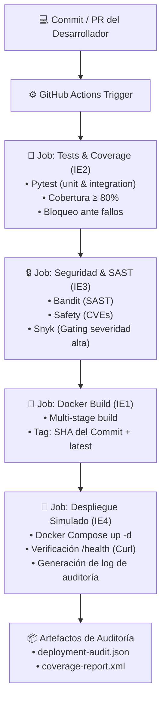

# Microservicio de Inventario y Catálogo — Pipeline CI/CD en GitHub Actions

> **Asignatura:** DOY0101 - Ingeniería DevOps  
> **Evaluación:** Evaluación Parcial N°2 (EP2) — *Añadiéndole complejidad a nuestro pipeline*  
> **Integrantes:** [Nombre Integrante 1] & [Nombre Integrante 2]  
> **Institución:** Duoc UC — 2026

---

## 1. Descripción del Proyecto

Este repositorio contiene la implementación integral del ciclo de vida (CI/CD) de un microservicio de **Gestión de Catálogo e Inventario de Productos**, desarrollado con **Python 3.12** y el framework **FastAPI**.

El microservicio expone una API REST moderna para la consulta, registro, actualización, eliminación y aplicación de reglas de negocio (descuentos en base a porcentajes y validación de inventario), incorporando endpoints de monitoreo y healthcheck nativos para Kubernetes y Docker.

Toda la integración, pruebas, análisis de seguridad y entrega continua están 100% automatizadas a través de un pipeline en **GitHub Actions**, cumpliendo estrictamente con los 5 indicadores de evaluación (IE1 al IE5) de la rúbrica oficial.

---

## 2. Arquitectura y Estructura del Repositorio

```text
devops/
├── .github/
│   ├── dependabot.yml              # [IE3] Configuración de escaneo semanal automatizado
│   └── workflows/
│       └── pipeline.yml            # [IE1-IE4] Pipeline CI/CD con gating y bloqueo
├── app/                            # Código fuente del microservicio
│   ├── __init__.py                 # Versión del paquete
│   ├── config.py                   # Configuración desacoplada por variables de entorno
│   ├── main.py                     # API REST FastAPI, middlewares y rutas
│   ├── schemas.py                  # Modelos Pydantic v2 (validación estricta de datos)
│   └── services.py                 # Lógica de negocio y persistencia en memoria
├── tests/                          # [IE2] Suite de pruebas automatizadas
│   ├── __init__.py
│   ├── conftest.py                 # Fixtures de Pytest y cliente HTTP de prueba
│   └── test_main.py                # Cobertura de rutas, casos de borde y errores (4xx/5xx)
├── k8s/                            # [IE5] Manifiestos de orquestación en Kubernetes
│   ├── deployment.yaml             # Deployment con 2 réplicas, probes y límites de recursos
│   ├── service.yaml                # Servicio de red ClusterIP
│   └── hpa.yaml                    # Horizontal Pod Autoscaler (HPA) por CPU y memoria
├── Dockerfile                      # [IE1] Multi-stage build optimizado, no-root y healthcheck
├── .dockerignore                   # [IE1] Minimización del contexto de construcción
├── docker-compose.yml              # [IE4, IE5] Orquestación local/simulada con réplicas y límites
├── requirements.txt                # Dependencias base de producción
├── requirements-dev.txt            # Dependencias de testing, cobertura y seguridad
└── README.md                       # Documentación técnica, trazabilidad y reflexiones
```

---

## 3. Cumplimiento de Indicadores de Evaluación (IE1 - IE5)

### IE1 · Contenedores e Imágenes Optimizadas (20%)
* **Construcción Multi-Etapa (Multi-Stage Build):**
  * **Etapa 1 (`builder`):** Instala los compiladores necesarios y empaqueta las dependencias de Python dentro de un entorno virtual aislado (`/opt/venv`).
  * **Etapa 2 (`runtime`):** Parte de la imagen base minimalista `python:3.12-slim`, copiando únicamente el entorno virtual empaquetado y el código fuente. Se eliminan compiladores, cachés de pip y herramientas innecesarias, reduciendo drásticamente la superficie de ataque y el peso de la imagen.
* **Seguridad No-Root:**
  * Se crea un usuario y grupo de sistema sin privilegios (`appuser:appgroup` con UID `10001`), evitando que el contenedor se ejecute con permisos de superusuario `root`.
* **Minimización de Contexto (`.dockerignore`):**
  * Se excluyen directorios de desarrollo como `.git`, `tests/`, `.venv`, cachés de bytecode (`__pycache__`) y documentación, garantizando builds reproducibles y veloces.
* **Healthcheck Integrado:**
  * Incluye instrucción `HEALTHCHECK` que utiliza la biblioteca estándar `urllib.request` de Python para monitorear `/health` cada 30 segundos sin necesidad de instalar dependencias externas como `curl`.

### IE2 · Pruebas Automatizadas y Políticas de Calidad (20%)
* **Cobertura de Casos Críticos:**
  * Rutas principales de la API (`GET /health`, `GET /api/v1/products`, etc.).
  * Lógica de negocio (algoritmo de cálculo de descuentos porcentuales y actualización de precios).
  * Manejo de errores y respuestas HTTP estándar (`404 Not Found` ante identificadores inexistentes, `422 Unprocessable Entity` ante payloads malformados o valores negativos).
* **Umbral de Calidad y Bloqueo:**
  * El pipeline ejecuta `pytest` junto a `pytest-cov` con la directiva `--cov-fail-under=80`. Si la cobertura del código es inferior al 80% o si tan solo un test falla, **el pipeline finaliza inmediatamente con código de error**, cancelando los pasos de empaquetado y despliegue.

### IE3 · Escalabilidad, Seguridad y Gobernanza (20%)
* **Escaneo Automatizado de Dependencias (Dependabot):**
  * Configurado en `.github/dependabot.yml` para revisar semanalmente (lunes a las 06:00 AM) tanto las dependencias del ecosistema `pip` como las acciones de `github-actions`.
* **Análisis Estático (SAST) y Vulnerabilidades:**
  * **Bandit:** Analiza estáticamente el código fuente en `/app` detectando prácticas inseguras (severidad media y alta).
  * **Safety:** Audita las librerías declaradas en `requirements.txt` frente a bases de datos de vulnerabilidades conocidas (CVEs).
  * **Snyk CLI:** Integrado en el pipeline con la regla `--severity-threshold=high`. Si se detecta una vulnerabilidad crítica o de alta severidad, el pipeline activa una alerta y **bloquea la ejecución**.
* **Parámetros de Escalabilidad:**
  * **Límites de Recursos:** Fijados en `0.50 CPU` y `256MB RAM` por réplica, con reservas mínimas de `0.20 CPU` y `128MB RAM`.
  * **Estrategia de Réplicas:** 2 réplicas activas para balanceo de carga y alta disponibilidad.

### IE4 · Despliegue Automatizado y Trazabilidad (20%)
* **Gating Estricto:**
  * El job `deploy` contiene la instrucción `needs: [test, security, build]`. Si cualquiera de las etapas previas falla, el despliegue no se inicia bajo ninguna circunstancia.
* **Entorno Simulado de Despliegue:**
  * Utiliza `docker-compose` en el runner para desplegar el stack completo, aplicando políticas de reinicio automático (`unless-stopped` / `on-failure`).
* **Verificación Activa (Smoke Test & Healthcheck):**
  * Tras el despliegue, el pipeline ejecuta reintentos hacia `http://localhost:8000/health` y valida el endpoint funcional de productos antes de dar la entrega por exitosa.
* **Trazabilidad de Punta a Punta:**
  * Cada imagen se etiqueta con el hash del commit (`${{ github.sha }}`) y con `latest`.
  * El pipeline genera y almacena un artefacto auditado `deployment-audit.json` con los metadatos de la entrega: fecha/hora UTC, autor del commit, rama, ID de ejecución y tag de la imagen generada.

### IE5 · Orquestación de Contenedores (20%)
El proyecto ofrece soporte de orquestación dual:
1. **Docker Compose (`docker-compose.yml`):**
   * Configuración de 2 réplicas mediante la sección `deploy.replicas`.
   * Limitación estricta de cómputo (`limits.cpus: "0.50"`, `limits.memory: "256M"`).
   * Monitoreo de estado con bloque `healthcheck` (intervalo de 15s).
   * Red bridge dedicada (`devops-network`).
2. **Kubernetes (`k8s/`):**
   * `deployment.yaml`: Controla 2 pods con política `RollingUpdate`, sondas `livenessProbe` y `readinessProbe`, y `securityContext` sin privilegios (`runAsNonRoot: true`).
   * `service.yaml`: Balanceo interno a través de servicio `ClusterIP`.
   * `hpa.yaml`: Escalabilidad horizontal automática basada en métricas de CPU (umbral 70%) y memoria (umbral 80%) entre 2 y 5 réplicas.

---

## 4. Cómo Garantizar la Trazabilidad y la Calidad

Para cumplir con la exigencia explícita del **Indicador IE4**, se detalla el flujo de trazabilidad y calidad aplicado:



1. **Trazabilidad de Código a Contenedor:** Cada contenedor generado tiene asignado el `GITHUB_SHA` del commit correspondiente. Esto permite rastrear con exactitud qué línea de código originó la versión que se encuentra en ejecución.
2. **Gating de Calidad:** Ningún artefacto puede ser desplegado si no ha superado el 100% de las pruebas unitarias y alcanzado el umbral del 80% de cobertura.
3. **Gating de Seguridad:** El pipeline detiene el despliegue ante vulnerabilidades altas o código no conforme a los estándares de seguridad.
4. **Registro de Auditoría:** Se genera en cada ejecución un reporte JSON inmutable que documenta el autor, la rama, el timestamp y el estado del healthcheck post-despliegue.

---

## 5. Instrucciones de Ejecución Local

### Prerrequisitos
* Python 3.12+ (o Python 3.11+)
* Docker y Docker Compose instalados

### Opción 1: Ejecutar directamente con Python
```bash
# Crear entorno virtual
python -m venv venv

# Activar entorno (Windows PowerShell)
.\venv\Scripts\Activate.ps1
# (Linux / macOS)
# source venv/bin/activate

# Instalar dependencias
pip install -r requirements-dev.txt

# Ejecutar las pruebas unitarias con reporte de cobertura
pytest tests/ --cov=app --cov-report=term-missing --cov-fail-under=80

# Levantar el microservicio localmente
uvicorn app.main:app --reload --port 8000
```
* Acceder a la documentación interactiva Swagger: [http://localhost:8000/docs](http://localhost:8000/docs)
* Acceder al healthcheck: [http://localhost:8000/health](http://localhost:8000/health)

### Opción 2: Ejecutar con Docker
```bash
# Construir imagen multi-stage
docker build -t product-inventory-microservice:v1.0 .

# Ejecutar contenedor como usuario no-root
docker run -d -p 8000:8000 --name mi-microservicio product-inventory-microservice:v1.0

# Verificar healthcheck
curl http://localhost:8000/health
```

### Opción 3: Orquestación con Docker Compose
```bash
# Levantar el servicio con réplicas y límites de recursos
docker compose up -d --build

# Ver estado de los contenedores y healthcheck
docker compose ps

# Ver logs
docker compose logs -f

# Detener el servicio
docker compose down
```

### Opción 4: Orquestación con Kubernetes (Minikube / Kind)
```bash
kubectl apply -f k8s/deployment.yaml
kubectl apply -f k8s/service.yaml
kubectl apply -f k8s/hpa.yaml

# Comprobar pods y réplicas
kubectl get pods -l app=product-service
kubectl get svc product-service
```

---

## 6. Declaración de Uso Ético de Inteligencia Artificial

De conformidad con las directrices académicas de la institución ([Bibliotecas Duoc UC - IA](https://bibliotecas.duoc.cl/ia)):

* **Herramientas utilizadas:** Antigravity (Google DeepMind - Gemini 3.8).
* **Finalidad del uso:**
  1. Apoyo en el diseño y estructuración de la arquitectura de carpetas para el pipeline de CI/CD.
  2. Generación de diagramas de flujo mediante sintaxis Mermaid.
  3. Revisión de sintaxis en manifiestos YAML de GitHub Actions y Kubernetes.
* **Validación técnica humana:** Todo el código fuente del microservicio, las aserciones de pruebas en Pytest, las configuraciones de seguridad de Dockerfile y las políticas de bloqueo en GitHub Actions fueron revisadas, ejecutadas y validadas técnicamente por el equipo estudiantil, asegurando su correcto funcionamiento y cumplimiento de los requisitos del proyecto.

---

## 7. Conclusiones y Reflexiones Individuales (Obligatorias)

> *Nota requerida por la rúbrica institucional:* Las siguientes reflexiones personales han sido redactadas de forma individual y autónoma por cada integrante del equipo, **sin la intervención de herramientas de Inteligencia Artificial**, reflejando el aprendizaje obtenido y el aporte individual durante el encargo.

### Reflexión Integrante 1: [Nombre y Apellidos del Integrante 1]
*(Completar con sus propias palabras: describir qué conocimientos adquirió en el diseño de contenedores y pipelines, cuál fue su contribución concreta al código o configuración, y qué dificultades enfrentó durante el trabajo).*

> "Durante el desarrollo de esta evaluación parcial, mi principal aporte se centró en... Pude comprender la importancia de implementar contenedores multi-etapa y configurar políticas de bloqueo en GitHub Actions para... Una de las mayores dificultades fue... logrando finalmente resolverlo mediante..."

### Reflexión Integrante 2: [Nombre y Apellidos del Integrante 2]
*(Completar con sus propias palabras: describir su rol en el testing, análisis de seguridad con Dependabot/Snyk, o despliegue automatizado, y cómo el proyecto impactó su visión de la cultura DevOps).*

> "En este proyecto, mi responsabilidad principal consistió en... Aprendí a integrar herramientas de análisis estático como Bandit y Snyk para prevenir vulnerabilidades antes del despliegue... Considero que la trazabilidad basada en el SHA del commit es fundamental en entornos corporativos porque..."

